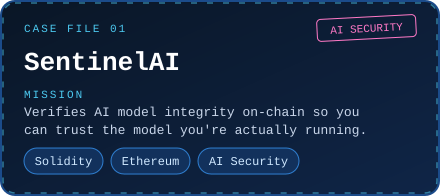
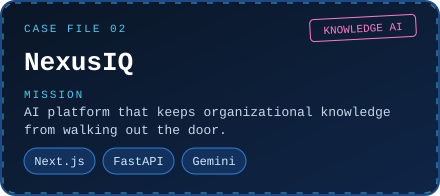
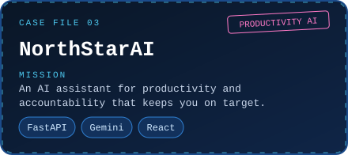
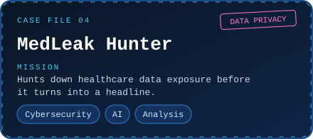
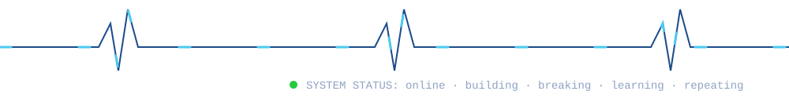

<div align="center">





<br><br>

<a href="https://www.linkedin.com/in/srijoni-ghosh-ba06a9379"></a>
<a href="mailto:srijonisonu@gmail.com"></a>
<a href="https://github.com/srijonighosh04"></a>


</div>

<!-- psst: reading the source? You're my kind of person. srijonisonu@gmail.com -->

<br>

## `// CASE FILES`

<div align="center">
<table>
<tr>
<td><a href="https://github.com/srijonighosh04"></a></td>
<td><a href="https://github.com/srijonighosh04"></a></td>
</tr>
<tr>
<td><a href="https://github.com/srijonighosh04"></a></td>
<td><a href="https://github.com/srijonighosh04"></a></td>
</tr>
</table>
</div>

<br>

## `// LOADOUT`

<div align="center">
<table>
<tr><td align="center"><sub><code>LANGUAGES</code></sub></td><td></td></tr>
<tr><td align="center"><sub><code>WEAPONS</code></sub></td><td></td></tr>
<tr><td align="center"><sub><code>VAULTS</code></sub></td><td></td></tr>
<tr><td align="center"><sub><code>GEAR</code></sub></td><td></td></tr>
</table>
</div>

<br>

## `// PATCH NOTES v2028.0`

```diff
+ Added:    unreasonable amounts of caffeine (debugging is my cardio)
+ Added:    a dog-approved code review process
+ Added:    passion for AI security (yes, it's a problem)
! Changed:  most productive hours → after sunset
- Removed:  fear of bugs (professional bug creator, even more professional exterminator)
~ Known issue: always learning something new, cannot be patched
```

<br>

## `// INTEL REPORT`

<div align="center">


<picture>

</picture>

</div>

<br>

## `// QUEST LOG`

- [ ] 💼 **Main quest:** land an internship
- [ ] 🔐 Build more AI + security projects
- [ ] 🌍 Contribute to open source
- [ ] 🧩 Level up DSA & system design
- [ ] 🔬 Side quest: AI security research

<details>
<summary><b>🔓 Secret vault</b> (click, if you dare)</summary>

<br>

Decrypt this to unlock the hidden message:

```
WW91IGZvdW5kIGl0ISBIaXJlIG1lOiBJIGRlYnVnIGluIG15IHNsZWVwLiBMZXQncyB0YWxrLg==
```

<sub>Hint: it's base64. Recruiters who solve it get bonus points.</sub>

</details>

<br>


